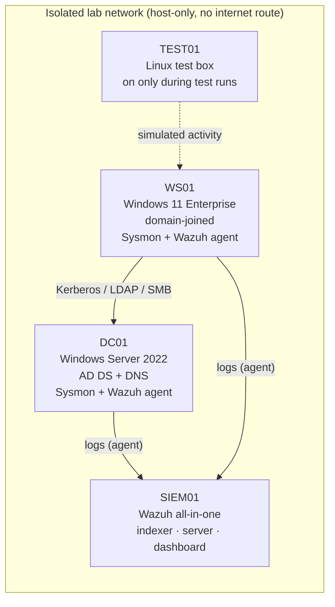

# SecOps AD Lab: detecting identity attacks across a corporate domain

> **Status: in progress.** Domain build underway. See [Roadmap](#roadmap) for what is done and what is next.

## The business problem

Almost every bank runs on Microsoft Active Directory, and most serious breaches move through it: an attacker gains one workstation, harvests credentials, and moves sideways until they control the domain. At that point, every important business service that depends on the domain is at risk.

This project asks one question: **if that happened in a small corporate network, would I see it, and could I show which control would have stopped it?**

## What this lab shows

- **Enterprise infrastructure:** a working AD domain with tiered admin accounts, OUs, Group Policy and domain-joined endpoints.
- **Visibility:** Sysmon and Windows audit logs centralised in a SIEM (Wazuh), with a documented telemetry coverage table.
- **Hardening:** a CIS-benchmark baseline measured before and after, with the risk rationale for each change.
- **Detection engineering:** adversary techniques simulated with Atomic Red Team, each mapped to MITRE ATT&CK, with a detection rule written, tuned and honestly scored as detected, partially detected or missed.
- **Risk communication:** an incident-style report and a one-page business companion framed against UK operational resilience expectations (PRA/FCA important business services and impact tolerances).

## Architecture




| Host | Role | OS | RAM |
| --- | --- | --- | --- |
| DC01 | Domain controller, DNS | Windows Server 2022 (evaluation) | 3 GB |
| WS01 | User workstation | Windows 11 Enterprise (evaluation) | 4 GB |
| SIEM01 | Log collection, detection, dashboards | Wazuh on Ubuntu | 4 GB |
| TEST01 | Simulation host | Linux | 2 GB |

All VMs run on a single 16 GB laptop on a host-only network, with clean snapshots for rollback.

## Results

_To be filled in as each phase completes._

| ATT&CK technique | Simulated with | Result | Detection |
| --- | --- | --- | --- |
| T1087 Account Discovery | Atomic Red Team | pending | |
| T1003 OS Credential Dumping | Atomic Red Team | pending | |
| T1558.003 Kerberoasting | Atomic Red Team | pending | |
| T1021.002 SMB / Admin Shares | Atomic Red Team | pending | |
| T1053.005 Scheduled Task | Atomic Red Team | pending | |

## Roadmap

- [ ] **Phase 1: Domain.** DC, OUs, tiered users and groups, workstation joined, baseline GPOs. → [docs/01-domain.md](docs/01-domain.md)
- [ ] **Phase 2: Visibility.** Sysmon, advanced audit policy, Wazuh agents, telemetry coverage table. → [docs/02-telemetry.md](docs/02-telemetry.md)
- [ ] **Phase 3: Hardening.** CIS baseline scan, remediation, before/after score. → [docs/03-hardening.md](docs/03-hardening.md)
- [ ] **Phase 4: Simulate and detect.** Five ATT&CK techniques, Wazuh and Sigma rules, coverage matrix. → [docs/04-detections.md](docs/04-detections.md)
- [ ] **Phase 5: Report.** Incident report and business companion. → [report/](report/)

Planned extensions: a second workstation, CI linting of Sigma rules, and an isolated OT/building-systems subnet for an IT-to-OT segmentation study.

## Repository layout

```
├─ docs/          phase write-ups and architecture diagram
├─ detections/
│  ├─ wazuh/      custom rules (local_rules.xml)
│  └─ sigma/      portable versions of each detection
├─ config/        Sysmon config, audit policy, GPO exports
├─ evidence/      screenshots
├─ report/        incident report, business companion
└─ lab-notes.md   what broke and how I fixed it
```

## Scope and safety

Everything here runs in an isolated, self-contained lab I own. Simulations use the open-source Atomic Red Team library against my own VMs only. No real credentials, personal data, or external systems are involved.

## About me

Built by **Amit Kiran Deb**, MSc graduate (results November 2026) with a background in OT security (IEC 62443, Purdue model), aiming at cyber security and technology risk roles in financial services.
[GitHub](https://github.com/Amitdeb00731) · LinkedIn: _add link_
