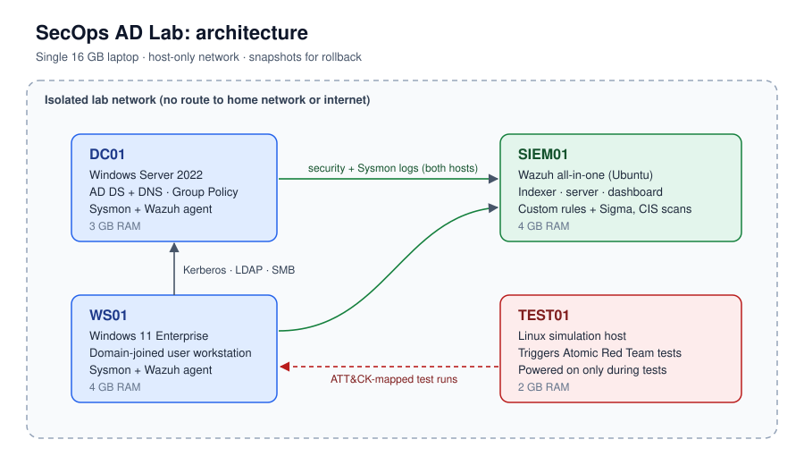
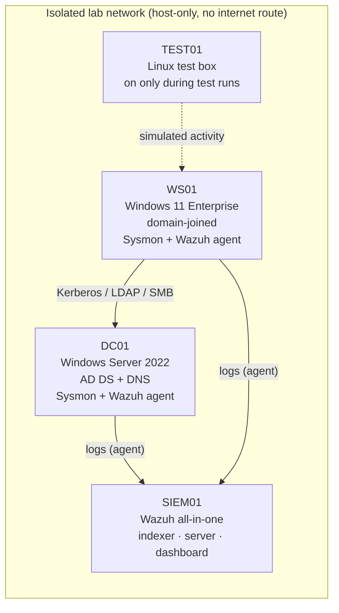

# SecOps AD Lab: detecting identity attacks across a corporate domain

> **Status: complete. All five phases delivered (domain, visibility, hardening, detection engineering, reporting); 5/5 ATT&CK techniques detected, one blocked by a Phase 3 control.** See [Roadmap](#roadmap).

## The business problem

Almost every bank runs on Microsoft Active Directory, and most serious breaches move through it: an attacker gains one workstation, harvests credentials, and moves sideways until they control the domain. At that point, every important business service that depends on the domain is at risk.

This project asks one question: **if that happened in a small corporate network, would I see it, and could I show which control would have stopped it?**

## What this lab shows

- **Enterprise infrastructure:** a working AD domain with tiered admin accounts, OUs, Group Policy and domain-joined endpoints.
- **Visibility:** Sysmon and Windows audit logs centralised in a SIEM (Wazuh), with a documented telemetry coverage table.
- **Hardening:** a CIS-benchmark baseline measured before and after, with the risk rationale for each change.
- **Detection engineering:** adversary techniques simulated with Atomic Red Team, each mapped to MITRE ATT&CK, with a detection rule written, tuned and honestly scored as detected, partially detected or missed.
- **Risk communication:** an incident-style report and a one-page business companion framed against UK operational resilience expectations (PRA/FCA important business services and impact tolerances).

## Architecture





| Host | Role | OS | RAM |
| --- | --- | --- | --- |
| DC01 | Domain controller, DNS | Windows Server 2022 (evaluation) | 3 GB |
| WS01 | User workstation | Windows 11 Enterprise (evaluation) | 4 GB |
| SIEM01 | Log collection, detection, dashboards | Wazuh on Ubuntu | 4 GB |
| TEST01 | Simulation host | Linux | 2 GB |

All VMs run on a single 16 GB laptop on a host-only network, with clean snapshots for rollback.

## Results

### Phase 1: domain (complete)
- `corp.lab` forest with tiered admin model: only `Administrator` and the dedicated Tier 0 account hold Domain Admins.
- Workstation local admin granted by AD group + GPO, verified on WS01; standard users confirmed non-admin.
- Audit baseline live on DC and workstation; failed Kerberos logons (Event 4771, code `0x18`) captured with user and source IP.
- Evidence: [validation](evidence/phase1/validation.md) · [GPO settings](config/gpo/README.md) · [write-up](docs/01-domain.md#8-phase-1-write-up) · [lab notes](lab-notes.md)

### Phase 2: visibility (complete)
- Wazuh 4.14 SIEM collecting Security, Sysmon and PowerShell logs from DC01 and WS01 through one central agent config.
- Telemetry coverage tested with 11 harmless actions: all 11 arrived in the SIEM.
- The logs surfaced a real control gap: the Tier 0 admin account had logged on to a workstation.
- Evidence: [coverage](evidence/phase2/telemetry-coverage.md) · [write-up](docs/02-telemetry.md#10-phase-2-write-up) · [agent config](config/wazuh/agent.conf) · [Sysmon config](config/sysmon/README.md)

### Phase 3: hardening (complete)
- 16 controls applied by Group Policy, each tied to the attack it stops and checked on the host.
- CIS score measured with Wazuh SCA: DC01 29% → 38% (34 checks fixed), WS01 27% → 33% (30 fixed), no regressions. These figures are the share of CIS benchmark checks passing before and after hardening (a measure of improvement), not a claim of formal CIS compliance or certification.
- Closes the Phase 2 finding: Tier 0 admins can no longer sign in to workstations; local admin passwords are now unique and rotated by Windows LAPS.
- Accepted risks kept on record (weak service account and RC4 left for Phase 4).
- Evidence: [hardening register](evidence/phase3/hardening-register.md) · [SCA comparison](evidence/phase3/sca-comparison.md) · [verification](evidence/phase3/verification.md) · [write-up](docs/03-hardening.md#8-phase-3-write-up)

### Phase 4: detection engineering (complete)
- Five ATT&CK techniques simulated with Atomic Red Team in the isolated lab, one at a time, each detection rule tuned against a real captured event and paired with a portable Sigma rule.
- Every technique detected at the intended severity; the LSASS dump was **blocked outright by the Phase 3 controls**, and the block was turned into its own alert after onboarding the Defender channel: the control/detection trade-off made explicit.
- Evidence: [coverage matrix](evidence/phase4/coverage-matrix.md) · [write-up](docs/04-detections.md#9-phase-4-write-up) · [rules](detections/wazuh/local_rules.xml) · [Sigma](detections/sigma/)

| ATT&CK technique | Simulated with | Result | Detection |
| --- | --- | --- | --- |
| T1087.002 / T1069.002 Account & Group Discovery | Atomic Red Team | Detected | Wazuh 100211 (level 10) + Sigma |
| T1558.003 Kerberoasting | Atomic Red Team | Detected | Wazuh 100220 (level 12) + Sigma |
| T1003.001 LSASS Credential Dumping | Atomic Red Team | Blocked + detected | Wazuh 100231 (level 12) + Sigma |
| T1021.002 SMB / Admin Shares | Atomic Red Team | Detected | Wazuh 100240 (level 12) + Sigma |
| T1053.005 Scheduled Task | Atomic Red Team | Detected | Wazuh 100250/100251 (level 12) + Sigma |

### Phase 5: report (complete)
- Incident report (IR-2026-001) covering the five techniques as a single intrusion: timeline, per-stage findings against the captured events, ATT&CK mapping, root cause, containment and recovery, and recommendations.
- One-page business summary framed against UK operational resilience (PRA/FCA important business services and impact tolerances) for a non-technical risk audience.
- Evidence: [incident report](report/incident-report.md) · [business companion](report/business-companion.md) · [index](report/README.md)

## Roadmap

- [x] **Phase 1: Domain.** DC, OUs, tiered users and groups, workstation joined, baseline GPOs. → [docs/01-domain.md](docs/01-domain.md)
- [x] **Phase 2: Visibility.** Sysmon, advanced audit policy, Wazuh agents, telemetry coverage table. → [docs/02-telemetry.md](docs/02-telemetry.md)
- [x] **Phase 3: Hardening.** CIS baseline scan, remediation, before/after score. → [docs/03-hardening.md](docs/03-hardening.md)
- [x] **Phase 4: Simulate and detect.** Five ATT&CK techniques, Wazuh and Sigma rules, coverage matrix. → [docs/04-detections.md](docs/04-detections.md)
- [x] **Phase 5: Report.** Incident report and business companion. → [report/](report/) ([incident report](report/incident-report.md) · [business companion](report/business-companion.md))

Planned extensions: a second workstation, CI linting of Sigma rules, and an isolated OT/building-systems subnet for an IT-to-OT segmentation study.

## Repository layout

```
├─ docs/          phase write-ups and architecture diagram
├─ detections/
│  ├─ wazuh/      custom rules (local_rules.xml)
│  └─ sigma/      portable versions of each detection
├─ config/        Sysmon config, audit policy, GPO exports
├─ evidence/      screenshots
├─ report/        incident report, business companion
└─ lab-notes.md   what broke and how I fixed it
```

## Scope and safety

Everything here runs in an isolated, self-contained lab I own. Simulations use the open-source Atomic Red Team library against my own VMs only. No real credentials, personal data, or external systems are involved.

## About me

Built by **Amit Kiran Deb**, MSc graduate (results November 2026) with a background in OT security (IEC 62443, Purdue model), aiming at cyber security and technology risk roles in financial services.
[GitHub](https://github.com/Amitdeb00731) · [LinkedIn](https://www.linkedin.com/in/amit-deb-038b642b5/)
