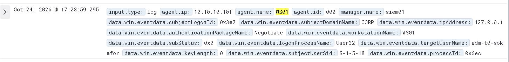

# Phase 3: verification evidence

Captured 24 October 2026. Status per control is tracked in the [hardening register](hardening-register.md).

## GPOs created and linked (DC01)

```text
GPO-Hardening-Workstations  -> OU=Workstations,OU=CORP,DC=corp,DC=lab   (6 registry settings, ComputerVersion 6)
GPO-Hardening-DC            -> OU=Domain Controllers,DC=corp,DC=lab     (7 registry settings, ComputerVersion 7)
Firewall policy (C14) written to both GPOs with Set-NetFirewallProfile -PolicyStore corp.lab\<GPO>
```

## C4 LSA protection (WS01)

```text
PS> Get-WinEvent -FilterHashtable @{LogName='System'; ProviderName='Microsoft-Windows-Wininit'; Id=12} -MaxEvents 1
TimeCreated          Message
24/10/2026 17:25:46  LSASS.exe was started as a protected process with level: 4.
```
**Proves:** LSASS runs as a protected process on WS01, so ordinary admin tools can't read its memory.

## C8 Tier 0 sign-in refused on WS01



Wazuh event from WS01 at 17:28:59: `targetUserName: adm-t0-sokafor`, `logonProcessName: User32` (interactive sign-in at the console), `workstationName: WS01`.
**Proves:** the attempt by the domain admin account to sign in to the workstation is recorded centrally. Event 4625 with status `0xC000015B` (the user has not been granted the requested logon type), confirmed in Wazuh on 24 Oct 2026. The sign-in was refused by policy, not by a wrong password.

## C9 Protected Users (DC01)

```text
PS> Get-ADGroupMember "Protected Users" | Select SamAccountName
adm-t0-sokafor
```

## Least-privilege computer join (DC01)

```text
PS> (Get-Acl "AD:OU=Workstations,OU=CORP,DC=corp,DC=lab").Access |
      Where-Object IdentityReference -like "*GG-Workstation-Admins*" |
      Select ActiveDirectoryRights, ObjectType, InheritedObjectType -Unique

ActiveDirectoryRights        ObjectType                            InheritedObjectType
CreateChild                  bf967a86-... (computer)               (this OU)
ReadProperty, WriteProperty  4c164200-... (User-Account-Restrictions)  computer
Self                         f3a64788-... (Validated write: SPN)   computer
Self                         72e39547-... (Validated write: DNS host name)  computer
ExtendedRight                00299570-... (Reset Password)         computer
```
**Proves:** GG-Workstation-Admins can create and join computer objects in the Workstations OU, and nothing more. No full control, no rights elsewhere. Tier 0 is no longer needed to join workstations.

## C6 / C15 SMB on DC01

```text
PS> Get-SmbServerConfiguration | Select RequireSecuritySignature, EnableSMB1Protocol
RequireSecuritySignature  EnableSMB1Protocol
True                      False
```
**Proves:** the DC requires SMB signing and has SMBv1 off.

## C10 Windows LAPS

WS01:
```text
PS> Invoke-LapsPolicyProcessing
PS> Get-WinEvent -LogName "Microsoft-Windows-LAPS/Operational" -MaxEvents 6
TimeCreated           Id     Level        Message
24/10/2026 18:17:07   10004  Information  LAPS policy processing succeeded.
24/10/2026 18:17:07   10020  Information  LAPS successfully updated the local admin account with the new password.
24/10/2026 18:17:07   10018  Information  LAPS successfully updated Active Directory with the new password.
24/10/2026 18:17:06   10015  Information  The managed account password needs to be updated ...
24/10/2026 18:17:06   10108  Warning      The msLAPSCurrentPasswordVersion attribute has not been added to the schema ...
24/10/2026 18:17:06   10055  Information  LAPS is using the following domain controller ...
```

DC01 (metadata only, password not displayed):
```text
PS> Get-LapsADPassword -Identity WS01 | Select ComputerName, Account, PasswordUpdateTime, ExpirationTimestamp
ComputerName  Account     PasswordUpdateTime     ExpirationTimestamp
WS01          localadmin  24/10/2026 18:17:06    23/11/2026 17:17:06
```
**Proves:** WS01's local admin password is now unique, random (15 characters, full complexity), stored encrypted in AD and rotated every 30 days. Warning 10108 refers to a newer optional schema attribute; LAPS works without it.

## C11 Print Spooler and C12 LDAP signing (DC01)

```text
PS> Get-Service Spooler | Select Status, StartType
Status   StartType
Stopped  Disabled

PS> Get-GPInheritance -Target "OU=Domain Controllers,DC=corp,DC=lab" | Select -Expand GpoLinks | Select Order, DisplayName
Order  DisplayName
1      GPO-Hardening-DC
2      Default Domain Controllers Policy
3      GPO-Audit-Baseline

PS> (Get-ItemProperty "HKLM:\SYSTEM\CurrentControlSet\Services\NTDS\Parameters").LDAPServerIntegrity
2
```
**Proves:** the spooler is off on the DC, and the DC refuses unsigned LDAP binds. LDAP signing only took effect after GPO-Hardening-DC was moved above the Default Domain Controllers Policy, which defines the same setting as *None*.

## C7 NTLMv2 only and C16 account lockout auditing (DC01 and WS01)

```text
PS> (Get-ItemProperty "HKLM:\SYSTEM\CurrentControlSet\Control\Lsa").LmCompatibilityLevel
5

PS> auditpol /get /subcategory:"Account Lockout"
Logon/Logoff
  Account Lockout                         Failure
```
Same result on both hosts.
**Proves:** both machines send and accept NTLMv2 only (LM and NTLMv1 refused), and account lockouts are now audited, which gives Phase 4 a signal for password spraying (T1110).
